# UPSC Today design preview

Screenshots from the working review branch, refreshed in Chromium on 12 October 2026. Click an image to view it at full size. These are static previews; the production site is not deployed from this branch.

The page begins with short articles, followed by a collapsed Study desk and the official update feed. It uses warm paper colours, restrained green accents, self-hosted fonts, and a focused article view. The five initial explainers now include worked illustrations, comparisons, source-reading locators and revealable recall answers. Search, saved takeaways, revision and the source archive remain available. The masthead slogans and repeated priority totals have been removed.

The article renderer now supports the older shared script interface, preventing cached scripts from leaving an empty reader. Asset URLs are versioned, and direct article links focus the loaded title. Pocket reads and Must Know article views share the same reading width, title sizing and responsive spacing.

Topic arrows now open articles: the title, excerpt and arrow are one keyboard-accessible link. Mobile arrows stay visible. The guide, Pattern Atlas, revision, Mains, quiz, verification queue and generated archive use the same fonts and reading palette. Navigation and filters wrap, touch targets are larger, and the article scroll position accounts for the sticky navigation's current height. Standalone pages also activate their mobile menus and theme buttons.

## Desktop reading room

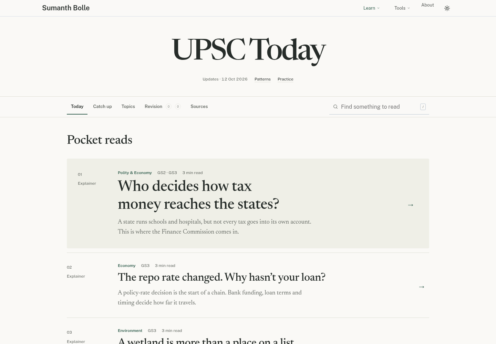

## Mobile reading room

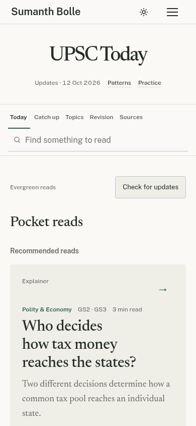

## Article view

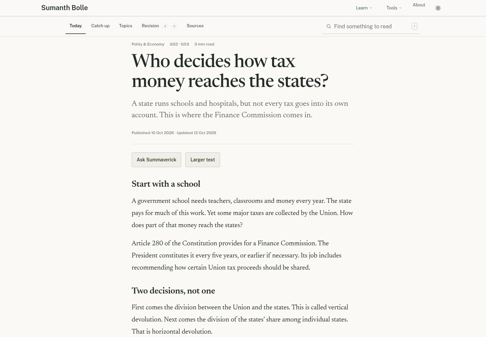

## Mobile dark theme

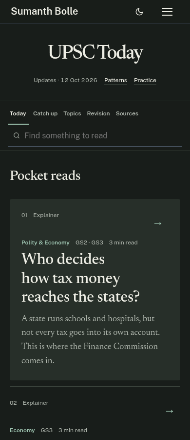

## Mobile article body

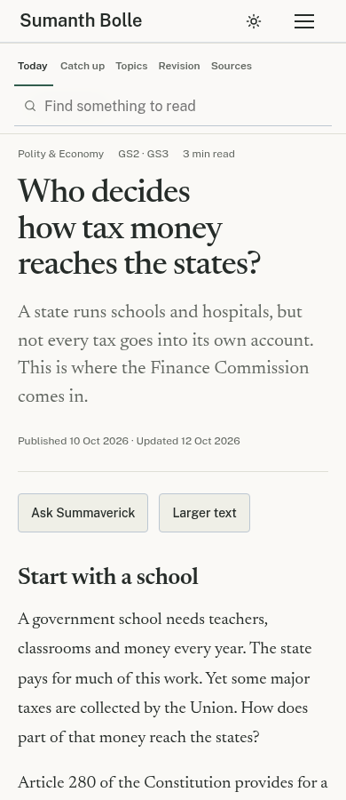

## Worked example and comparison

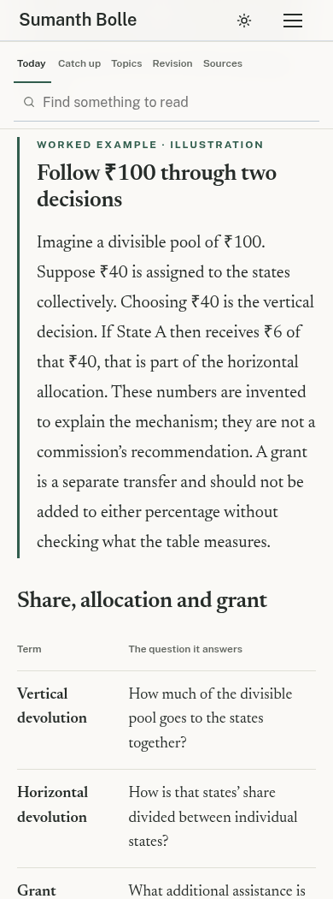

## Ask Summaverick

The article action opens this panel with the current article and its source references. The replies below are explicitly labelled layout fixtures, not live research results. Direct source downloading requires the Worker update to be deployed; no live source answer was verified from this environment.

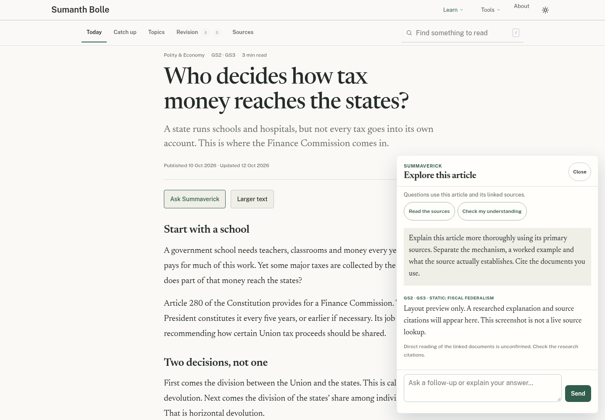

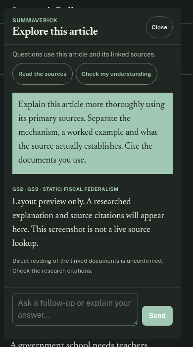

## Must Know source brief

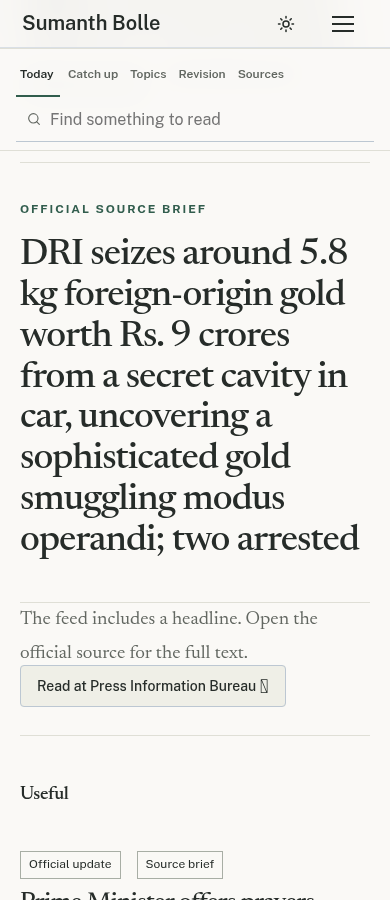

## Pattern Atlas

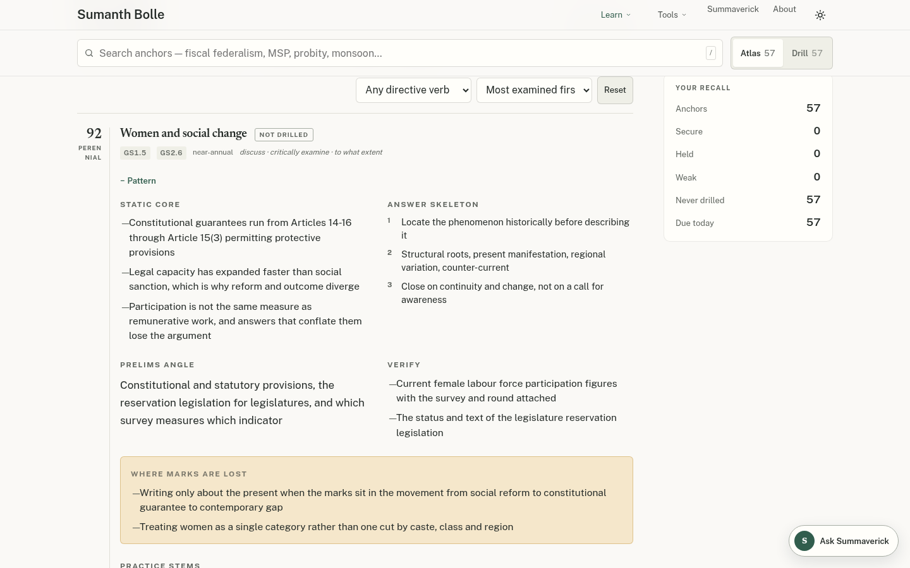

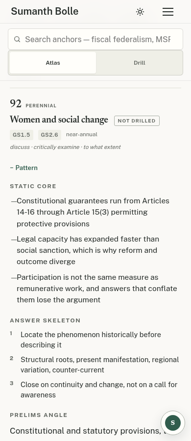

## Guide and revision

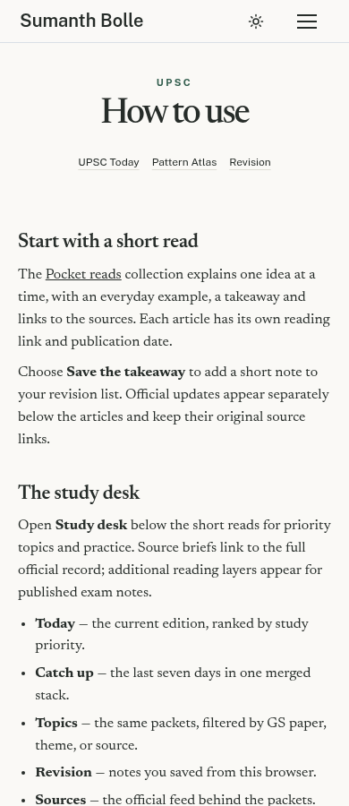

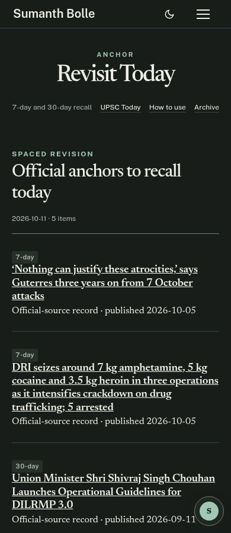

## Topics on a small phone

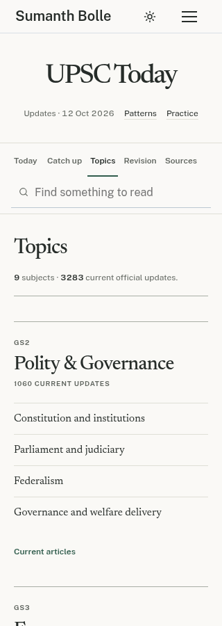

The initial articles are evergreen explainers. The official update feed refreshes through its existing scheduled workflow. A separate daily job releases at most one approved evergreen Pocket read around 07:00 Singapore time after merge; its queue is initially empty and it does not author text. Dynamic Pocket news has a separate frequent source/verification pipeline and a Worker feed, without that daily limit. Activation requires the credentials and deployment documented below. See [publishing and source research](../upsc-pocket-publishing.md) and the [reading review](../upsc-reading-review.md).

Validation: 16 UPSC JavaScript check scripts and 87 publisher tests passed. Browser checks cover complete article bodies, arrows, keyboard/new-tab navigation, the older renderer interface, direct links, saving, eight responsive routes, forms and Atlas drill. Source-widget checks cover all article additions, source-URL requests, understanding-check replies, focus restoration, a compact keyboard viewport and cancelled requests on article navigation. The Worker dry-run build passes; deployment and live-provider validation remain pending.

## Incoming news and source corrections

These two screenshots use clearly labelled layout fixtures, not real published news or proof of a deployed live feed. The first demonstrates an incoming Pocket news row and its date. The second shows a withdrawn current note: its warning remains visible and stale save/ask actions are disabled until the latest reads are loaded.

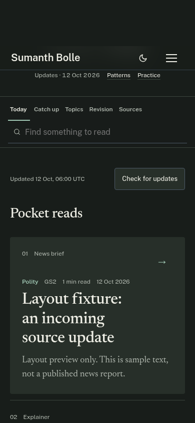

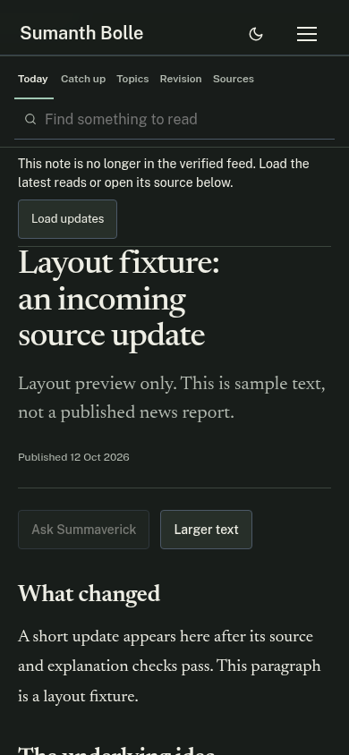

The dynamic browser checks pass for automatic library updates, conditional requests, preserved article DOM/context, Back navigation, corrected/withdrawn notes, and retaining a newer snapshot during an outage. Actual deployment remains blocked by missing secure credentials. See [Pocket publishing](../upsc-pocket-publishing.md) for the five-minute source polling schedule, 30-second visible-page checks and their latency limits.
